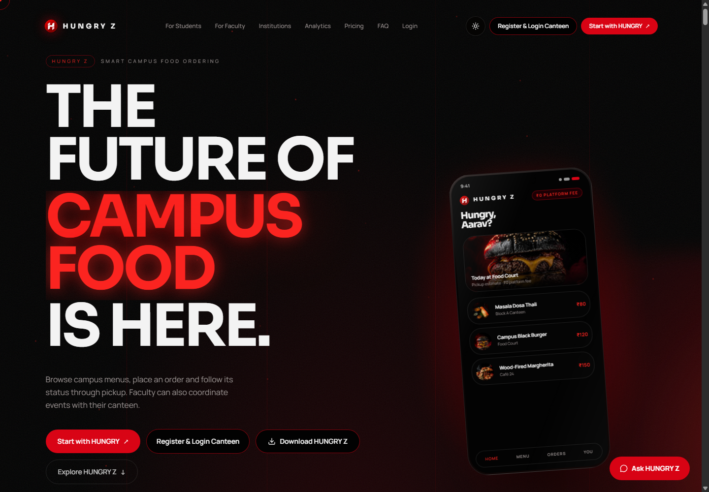
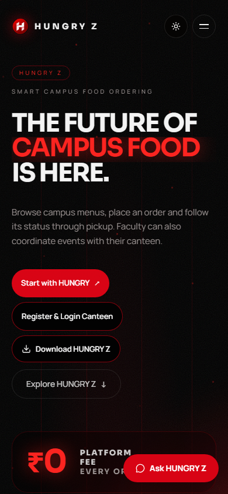

# HUNGRY Z

### Campus food ordering and event service, in one place.

HUNGRY Z connects students, faculty and campus canteens through digital menus, pickup orders and faculty-managed events. Students can follow an order to pickup or use a published event code to request a capacity-limited participation token. Canteen owners manage service from a dedicated dashboard.

[Open HUNGRY Z](https://hungryz.vercel.app/) · [Setup guide](docs/SETUP.md) · [Architecture](docs/ARCHITECTURE.md) · [Repository](https://github.com/aalexpaulofficial-spec/HUNGRYZ-V1-TESTING)

<p align="center">
  
</p>

## Product preview

The screenshots below show the HUNGRY Z landing page at desktop and mobile widths.

<p align="center">
  
</p>

<p align="center">
  
</p>

## One platform, four roles

### Students

- Browse approved participating canteens and their available menus.
- Place Dine In or Parcel orders, choose an available payment method, and follow order status to pickup.
- View pickup details and QR codes for supported orders.
- Open **Faculty Events**, enter a seven-digit event code, review event details and generate a four-digit participation token with a QR code while approved capacity remains.
- Use **HUNGRY AI Scan** for food and nutrition estimates.

### Faculty

- Submit a canteen event request with event details, expected participants and a seven-digit access code.
- Select menu items and quantities, and optionally include a message to the canteen. A menu selection or a message is sufficient to submit.
- Review the canteen's item availability, alternatives and quotation; request changes or approve the quote.
- Track participation and event capacity through the faculty dashboard.

### Canteen owners

- Manage a menu, prices, item availability, operating availability and active orders from a separate owner dashboard.
- Review faculty event requests, confirm or suggest items, enter prices and an estimated budget, and send a quotation.
- Publish an event after faculty approval and verify participation tokens as students are served.
- Review sales and service information in the canteen analytics view.

### HUNGRY Z administrators

- Review canteen applications and manage approved canteens.
- Manage coupons, payment records, refund requests and transactional email logs.

## How the event flow works

```text
Faculty submits request
        ↓
Canteen reviews items and sends quotation
        ↓
Faculty requests a change or approves
        ↓
Canteen confirms and publishes
        ↓
Student enters event code and generates a token
        ↓
Canteen verifies token and serves the participant
```

Event participation uses the event-token flow. It does not go through the regular food cart or checkout.

## Platform capabilities

- Separate student, faculty, canteen-owner and administrator experiences.
- Campus/canteen access codes and separate canteen-owner credentials.
- Dine In and Parcel ordering, menu availability and order status updates.
- Razorpay online payment where available and pay-at-counter ordering. Parcel orders are counter-paid.
- Server-validated coupons, stock handling, duplicate-order protection and refund workflows.
- Faculty event quotations, approval, publishing, capacity tracking and token verification.
- HUNGRY AI Scan and a website help assistant with English, Hindi and Kannada responses.
- Light and dark interface themes across the product.
- Transactional email for supported account, order, payment and refund events.

Feature availability can depend on the canteen, order type, account and configured services. See the live product for the current experience.

## Technology

| Area | Implementation |
| --- | --- |
| Web application | React 19, TypeScript, TanStack Start and TanStack Router |
| Styling and interface | Tailwind CSS, Radix UI and Lucide icons |
| Data and identity | Supabase Auth, PostgreSQL, Row Level Security and Realtime |
| Database evolution | Drizzle schema and SQL migrations in `drizzle/` |
| Payments | Razorpay integration with server-side verification and webhook handling |
| Email | Nodemailer and configured SMTP transport |
| Tests and build | Vitest, Testing Library, Vite and TypeScript |

See the [architecture overview](docs/ARCHITECTURE.md) for application boundaries and key workflows.

## Run locally

Requirements: Node.js, npm, and the Supabase and service configuration described in the [setup guide](docs/SETUP.md).

```bash
npm install
npm run dev
```

The application reads environment values listed in [`.env.example`](.env.example). Configure the required local values before using authenticated, database-backed or payment features.

Useful project commands:

```bash
npm test          # Run the Vitest suite
npm run build     # Build the application
npm run preview   # Preview the production build
npm run lint      # Run ESLint
```

## Database and deployment notes

`drizzle/migrations/` is the application's current migration history. Apply migrations through the project's configured Supabase deployment workflow and review each migration against the target database before applying it. The older `database/*.sql` scripts are retained as historical setup references; do not blindly rerun them against a database already managed by Drizzle migrations. Environment, Supabase, Razorpay and email setup details are in [`docs/SETUP.md`](docs/SETUP.md).

## Repository guide

| Path | Purpose |
| --- | --- |
| `src/routes/` | Landing page, dashboards, legal pages and server/API routes |
| `src/components/foodexa/` | Student, faculty and canteen-facing interface components |
| `src/lib/` | Domain workflows, server functions, integrations and shared utilities |
| `drizzle/schema.ts` | Typed database schema |
| `drizzle/migrations/` | Database changes and security policies |
| `docs/SETUP.md` | Local and service configuration guide |
| `docs/ARCHITECTURE.md` | System boundaries and workflow notes |
| `docs/screenshots/` | Repository showcase screenshots |

## Support

For product support, email **hungryofficialx@gmail.com**. For code questions or a bug report, open an issue in this repository and include the relevant route or workflow; never include passwords, access tokens or payment credentials.

---

<p align="center">HUNGRY Z · Campus food, made easier.</p>
