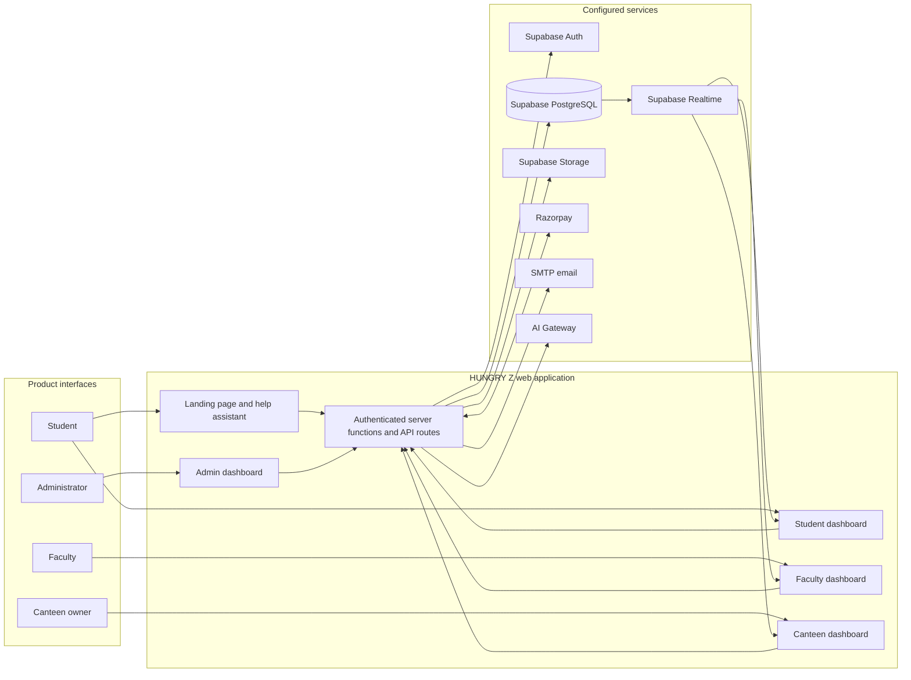

# HUNGRY Z architecture

This document describes the main application boundaries visible in the repository. It is a code-oriented overview, not a deployment inventory; enabled providers and available features depend on environment configuration.

## System map

## Application layout

- `src/routes/` defines the public landing page, authentication, role dashboards, legal pages and API endpoints.
- `src/components/foodexa/` contains the product-facing dashboard sections and reusable flows.
- `src/lib/` contains shared domain logic, typed server functions, validation and service integrations.
- `drizzle/schema.ts` and `drizzle/migrations/` define the PostgreSQL model and incremental database changes.
- Supabase Auth identifies users. Database access is scoped through Row Level Security policies and server-side authorization checks.

The browser uses the Supabase client for user-scoped reads and realtime subscriptions where appropriate. Privileged operations are handled by server functions or API routes, with secrets kept in server environment configuration.

## Main workflows

### Food ordering

1. A student selects an approved canteen, reviews its current menu and chooses Dine In or Parcel.
2. The application validates order data and applicable coupon/stock rules through the order workflow.
3. Pay-at-counter orders remain unpaid until handled at the canteen. Dine In can offer Razorpay online payment when configured. Parcel is pay-at-counter.
4. Online payment state is updated after server-side payment verification or a valid Razorpay webhook; the client is not the source of payment confirmation.
5. Students and canteen owners can follow the order's supported status and pickup flow.

### Faculty event participation

1. Faculty submit event details, expected capacity and a seven-digit event code. They may include menu quantities, a canteen message, or both; at least one of menu selection or message is required.
2. The canteen reviews requested items, confirms availability or suggests alternatives, enters prices and sends a quotation.
3. Faculty can request a revision or approve the quote. The canteen confirms and publishes the event after approval.
4. An eligible signed-in student enters the event code and requests a four-digit token while capacity remains. The token is presented with a QR code.
5. Canteen staff verify tokens and track event serving from the canteen workflow.

This event participation flow is separate from a normal food order and does not use the food cart or checkout.

### Refunds

Refund eligibility is reviewed through the application's refund flow; cancellation alone does not establish eligibility. A refund is initiated through the payment provider and remains in progress until provider confirmation is received. The student-facing order details expose refund status, and configured transactional email updates are sent for refund events.

### Food scan and website help

HUNGRY AI Scan is available as a student-facing food and nutrition estimate workflow. The public landing page also provides a website assistant with English, Hindi and Kannada responses. These are guidance and estimate features, not substitutes for provider payment records or verified nutrition labeling.

## Data and trust boundaries

| Boundary | Responsibility |
| --- | --- |
| Browser | Render interfaces, collect user input and call user-scoped reads or server functions. Do not treat browser state as authorization or payment proof. |
| Authentication | Supabase Auth provides user identity; role and canteen ownership checks gate dashboard access and actions. |
| PostgreSQL | Stores application records. RLS policies restrict authenticated reads and writes; server workflows enforce multi-step domain rules. |
| Server functions/API | Validate input and authorization, run privileged integrations and keep secret keys out of browser code. |
| Payment provider | Razorpay handles online payment/refund processing. Verified callbacks/webhooks determine the confirmed provider state. |
| Storage | Supabase Storage serves configured product assets. Private documents require private buckets, object-level policies and authorized server-side access. |

Review the relevant SQL migration and Supabase policy before enabling a new data flow. Never expose Supabase service-role credentials, Razorpay secrets, SMTP passwords or personal government documents in public buckets or client bundles.

## Repository conventions

- Add schema changes as incremental SQL migrations under `drizzle/migrations/` and keep `drizzle/schema.ts` aligned.
- Keep privileged writes and third-party secrets on the server; use RLS and explicit role/ownership checks.
- Treat payment and refund status as provider-confirmed state and make webhook handling safe to retry.
- Preserve the existing role flows and English, Hindi and Kannada user-facing support when changing shared interface behavior.
- Use the [setup guide](SETUP.md) for local environment and service configuration. Historical SQL files under `database/` are not a substitute for the current Drizzle migration history.
